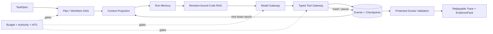

# Horizon — Recoverable Coding Agent Harness

[](https://github.com/caoshangrui-spec/horizon-coding-harness/actions/workflows/ci.yml)
[](https://github.com/caoshangrui-spec/horizon-coding-harness/actions/workflows/full-checkout-evidence.yml)

[](https://github.com/caoshangrui-spec/horizon-coding-harness/releases/tag/v0.3.0)


Horizon 是一个面向长程软件工程任务的**可恢复执行控制层**。它让 Coding Agent 在模型调用、
工具执行、进程重启和验证之间保留可审计状态，并以预算、权限和证据门禁约束每一步。

它不是另一个聊天界面。核心问题是：当任务跨越多个模型—工具轮次、Worker 发生故障、上下文
需要压缩或费用即将耗尽时，如何继续执行而不重复付费、不丢失事实、不越权，也不把部分成功
包装成完成。

> **当前状态：** v0.3.0 是已发布版本。它包含五项目完整 checkout A/B，以及 youtube-dl、
> Luigi 与 FastAPI 三个独立的三 WorkItem／两次 Worker 重启场景；它们分别通过本地可信执行和
> 公开禁网 Docker 5/5、3/3。该版本还加入父控制器硬退出后的持久 PID 启动闸门与精确停止确认，
> 并让来源绑定 suite 直接输出耗时、恢复成功率、恢复重派、重复副作用、Trace 完整性与最终悬空
> effect 指标。八次真实模型 Pilot 均为负结果，因此目前**不宣称真实 Issue 成功率或官方
> benchmark 成绩**。完整范围与证据边界见 [v0.3.0 release notes](docs/release-v0.3.0.md)。

## 为什么值得看

- **可恢复执行**：追加式事件、幂等命令、Worker Lease/epoch、内容寻址 checkpoint、本地顺序
  Supervisor 安全接力、父控制器硬退出后的 PID 绑定恢复，以及模型、工具和 promotion 提交窗口
  的保守恢复。
- **上下文与知识**：字符、保守 input-token 与剩余费用余量共同约束的确定性投影、不可丢失的
  Mandatory Facts、有来源的 Run Memory，以及绑定 workspace revision 的 SQLite FTS5 Code RAG；
  最小安全投影仍超限时在模型派发前持久等待，充分扩容后从原 transcript 安全续跑。
- **验证与治理**：有界工具权限、禁网 Docker 验收、Campaign/Run 双层费用门禁、持久化 HITL、
  单次证据驱动 replan 和可离线重放的 JSONL Trace。
- **保守意图入口**：`horizon intake route` 将控制请求、任务类型和执行模式结构化；显式控制命令
  与确定性规则不调用模型，原文证据区间和 admission 费用一并输出，识别只能收窄既有权限。
  模糊或读写冲突请求显式拒绝猜测；分类模型与 intake 持久事件尚未接入。

## 架构



详细数据流、恢复不变量和模块边界见
[开发设计](docs/coding-agent-development-design.md) 与
[能力设计](docs/agent-capabilities-design.md)。若用于面试，先看
[3 分钟演示与架构讲解](docs/interview-demo.md)。

意图入口可独立演示，不创建 Run、不读取 API Key，也不执行工具：

```powershell
uv run --locked --cache-dir .uv-cache horizon intake route `
  "修复空输入崩溃，但不要改代码，先给方案" `
  --repository . --authority workspace_write
```

输出同时给出 `task_kind=bugfix`、`requested_execution_mode=plan_only`、有效只读工具、原文触发
区间、`admission_model_calls=0` 和 `admission_cost_cny=0`。`admission_ready=false` 表示仍缺字段或存在
未执行的模型分类，不代表 Harness 已经启动任务。

## 60 秒演示

```powershell
uv sync --locked
$result = uv run --locked --cache-dir .uv-cache horizon demo run | ConvertFrom-Json
uv run --locked --cache-dir .uv-cache horizon demo verify-portfolio `
  "$($result.evidence_pack)"
```

这条命令无需 API Key、Docker 或网络。它先故意触发一次结构化工具错误并完成安全 Worker
交接；`lease_epoch=2` 的真实子进程随后在文件写入生效、tool receipt 尚未提交时用
`os._exit(86)` 硬退出。控制器只把悬空 intent 标为 `unknown`，核对唯一后态后显式接纳既有
写入且不重复执行，再由 `lease_epoch=3` 继续保护性验证、Trace 重放和 EvidencePack 自检。
v3 报告同时保存硬退出证据以及检索 Artifact → 写入上下文 → 目标/旧文本/revision lineage。
模型动作由冻结脚本提供，外部费用为 0。输出合同见
[作品集演示文档](docs/portfolio-demo.md)。

若只想在几秒内展示“真实直接子进程超时 → 先落取消栅栏 → terminate/wait → Trace 脱库
复核”，可运行零模型、零 Docker 的窄演示：

```powershell
uv run --locked --cache-dir .uv-cache horizon demo process-timeout
```

它不会执行仓库代码，严格边界与 EvidencePack 文件合同见
[直接子 Worker 超时取消演示](docs/process-timeout-cancellation-demo.md)。

需要一次查看“自动恢复”和“安全阻塞”两类结果时，可运行：

```powershell
uv run --locked --cache-dir .uv-cache horizon eval recovery `
  benchmarks/recovery/horizon-recovery-matrix-v3.yaml
```

冻结 v3 原样保留 v2 的 20 例，并新增“source promotion 已落盘、receipt 尚未发布”的真实子进程
硬崩溃。恢复必须识别精确既有 effect、只补 receipt，不能再次写入目标。当前结果为 21/21、
自动恢复 11/11、安全阻塞 10/10、恢复重派与重复副作用均为 0；三条硬崩溃 Trace 均会再次
重放。这仍不是完整故障矩阵。合同见
[有界恢复矩阵评测](docs/recovery-matrix-evaluation.md)。

## 已验证证据

| 证据面 | 当前结果 | 严格边界 |
|---|---|---|
| 公共 CI | main 的[标准 CI](https://github.com/caoshangrui-spec/horizon-coding-harness/actions/workflows/ci.yml)运行离线回归和两条演示；主作品集演示删除数据库后独立复核，并把完整目录发布为保留 14 天的 `horizon-portfolio-evidence`，同时发布 `horizon-process-timeout-evidence`；[禁网 Docker Evidence](https://github.com/caoshangrui-spec/horizon-coding-harness/actions/workflows/full-checkout-evidence.yml)独立运行 | CI 不读取 API Key、不运行付费模型；workflow artifact 通常需要登录 GitHub 下载，不是永久发布资产 |
| 离线回归 | `647 passed, 11 skipped` | 跳过项是需要本机 Docker 的契约测试 |
| [通用终态 EvidencePack](docs/terminal-evidence-pack.md) | `SUCCEEDED`、`FAILED`、`CANCELLED` 均可导出并离线复核 Trace、最终投影和 schema v2 可靠性摘要；区分 unknown 验收、已知 check 失败与 unknown/open effect，真实检索降级与工具回执原子绑定，确定性上下文折叠以 `context_compacted` 单独标记，兼容验证 schema v1 | model fallback、语义摘要和 model degradation 尚无 Trace history；自洽哈希不是来源签名，也不证明外部 Provider 或副作用已结清 |
| [终态 Run 顺序汇总](docs/terminal-suite-evaluation.md) | 有序聚合已有终态 Run；递归验证每个子 EvidencePack，分列结果、验收未知/失败、clean/quality-flagged success、检索降级与 unknown/open effect | 不执行任务，不是 batch scheduler，也没有并发性能声明 |
| [可恢复的顺序 Agent 任务批次](docs/sequential-agent-batch.md) | `agent batch` 按 1～100 条 TaskSpec manifest 顺序执行；任务间原子保存 checkpoint，确定性 invocation/Run receipt 支持重启识别，终态失败原样记录后继续，非终态/不确定 case 阻塞后项；全部闭合后复用 terminal-suite | 单机并发度 1；不自动越过人工/悬空 effect/旧 Worker 边界，不是 20～30 个真实模型任务成绩或吞吐声明 |
| [本地顺序 Supervisor](docs/local-sequential-supervisor.md)、[正式子进程模式](docs/local-process-supervisor.md)与[父控制器硬退出恢复](docs/parent-controller-crash-recovery.md) | `--supervise` 支持安全轮次接力；`agent run/resume --worker-process` 让每个 slice 由真实直接子进程持有 Lease，并在放行前持久化 PID launch 与启动授权。父 CLI 正常同步回收后再换 epoch；父进程被硬 kill 时，重启后的新 Lease 必须等待 TTL 并精确确认旧 PID 已停止。`Ctrl+C` 与显式 slice timeout 仍先写取消栅栏再停止/reap，pending intent 显式阻塞且零重派 | 只管理一个本地直接子进程；父崩溃恢复依赖操作者核实精确 PID，不自动探活/kill；不覆盖 OS 掉电/内核恢复、PID reuse 自动判定、任意后代进程、跨主机、队列或任意 effect exactly-once |
| [可恢复上下文容量暂停](docs/context-projection.md) | 必保前缀或 incomplete turn 在最小合法投影下仍超限时，Provider 派发前生成 typed stop、进入等待并释放 Lease；真实子进程退出后父进程仍按 PID reap。充分扩容的本机决定与消息不变的新 session 边界原子发布，再由新 PID 完成 protected validation；停止请求零模型派发、零 Campaign attempt | 这是独立 Scripted Model/进程故障回归，不属于主作品集 EvidencePack 的写入崩溃 Trace；不证明语义压缩质量、任意 Provider context window 或跨主机恢复 |
| [直接子 Worker 超时取消 EvidencePack](docs/process-timeout-cancellation-demo.md) | 一条零费用命令启动真实直接子进程；ready handshake 绑定 launch ID/PID/Lease/epoch/event hash，离线验证持久启动授权、取消围栏、同步 reap 与终态顺序；标准 CI 同步发布限时 artifact | 只证明一个本地直接子进程的父侧 timeout 与同步 reap；不是父/OS 自动恢复、进程树/跨主机控制、任意 effect 恢复或 exactly-once |
| [Docker `created` 执行子进程退出 EvidencePack](docs/docker-created-recovery-evidence.md) | Docker effect-executor 在 `create` 后、`start` 前以 34 退出；存活控制器观察 `created`、精确删除并持久化 `discard_check` receipt，Trace 可离线重放 | 未覆盖 Lease-owning Agent Worker 自身崩溃；也不是任意崩溃、外部副作用不存在或 exactly-once 证明 |
| [Docker `created` 续跑到终态](docs/docker-created-resume-to-terminal.md) | 在上述安全边界后由新 Worker epoch 继续；旧 call 不重派，新 call 使用同一 immutable image ID 执行 protected validation 并最终 `SUCCEEDED`；本地与[公开 Linux workflow](https://github.com/caoshangrui-spec/horizon-coding-harness/actions/runs/39803245157)均通过 | 使用合成 marker 与 Scripted Model；不是 Agent Worker 崩溃自动接管、真实模型能力或官方任务成绩 |
| [Lease-owning Agent Worker Docker 崩溃恢复](docs/docker-worker-crash-resume.md) | 真实子 Worker 运行生产 Agent Loop，在 `create` 后以 34 退出；父控制器按已回收 PID/旧 Lease/epoch/session 接管，epoch `1→2→3` 精确丢弃旧 attempt，再由新进程/new call 完成 protected validation 并 `SUCCEEDED`；本机与[公开 Linux workflow](https://github.com/caoshangrui-spec/horizon-coding-harness/actions/runs/39809773689)均通过 | 仅覆盖一个本地直接子进程和一个故障窗口；不覆盖父控制器/OS 重启、进程树、跨主机、任意崩溃或 exactly-once |
| Docker 契约 | 11 项已在本机已有镜像和公开 Linux runner 上分别通过 | 有限隔离与恢复合同，不是恶意代码安全认证 |
| 一键崩溃恢复演示 | 子进程在 `replace_text` 生效后、receipt 前以退出码 86 硬退出；悬空调用先标 unknown，再按精确 manifest 接纳一次并恢复到 epoch 3 | 固定离线脚本与单一写入窗口，不代表任意进程/主机故障恢复 |
| 有界恢复矩阵 v3 | 21/21；自动恢复 11/11、安全阻塞 10/10、incorrect resume 0、恢复重派/重复副作用 0；含 3 个真实硬退出和 Trace replay | 其余 18 例是生成 fixture 的状态/决策矩阵，不是完整 8 故障点或主机故障验收 |
| [外部 RAG 定位集 v3](docs/retrieval-evaluation.md#10-24-案例外部定位集与-v030-development-基线) | 先冻结 7 项目 24 个 BugsInPy 案例；当前只揭示 16 个 development，8 个 holdout 仍密封。4 个门控设计案例上，选择性策略把 Hit@8 13/16→16/16、路径 Recall 23/32→30/32；其余 12 个案例的 48 条扩展查询则只有两条 identifier rank 3→2，中文仍为 3/12。新的保守 CJK 候选在 4 条高覆盖查询保持 4/4 Hit、7/8 路径召回，并对 12 条低覆盖中文精确旁路；[历史真实模型查询审计](docs/retrieval-evaluation.md#16-历史真实模型查询形态审计)又从 7 份 Trace 的 10 次检索中哈希确认 6 次、3 种公开查询，均为原样旁路 | 保留原文与直接替换在四例排名完全相同，且这四例参与过词表设计；低覆盖旁路复用旧 baseline 而非新运行。真实模型审计仍有 4/10 原文为 `UNKNOWN`，只覆盖两个任务和单一模型。默认 runtime 不变，全部证据仍不代表查询分布泛化或端到端修复成功率 |
| [24 条独立任务注册表](docs/independent-task-registry.md) | 原样绑定预冻结的 16 development / 8 holdout，按仓库 URL + BugsInPy bug ID 得到 24/24 唯一身份；零费用预检交叉验证 commit、license 元数据、失败测试及现有证据。当前 16 条有源码物化配方，15 条有执行 manifest，其中 14 条为完整 checkout | 预检不联网、不执行仓库代码；仍有 9 条无执行 manifest，其中 8 条是密封 holdout，另 1 条 development 因上游符号链接被安全快照门拒绝；这不是 24 条真实模型成功率 |
| 外部来源裁剪 A/B v2 | 5 个来源绑定案例的初始失败、Baseline 等待和 Treatment 修复均由本地可信与公开禁网 Docker 执行，证据已上传 | 使用 Scripted Model 和 dependency-reduced fixture，不是 BugsInPy 官方成绩 |
| [完整 checkout A/B v11](docs/full-checkout-pilot.md) | v10 十九例原样保留，再加入 Sanic route host、TheFuck Bitbucket suggestion 与 Luigi running-task ownership；共 22 案例、9 个项目、6,062 files。三例均由本地完整 Harness 确认 buggy 失败、Baseline 等待、Treatment 恢复；[公开禁网 Docker](https://github.com/caoshangrui-spec/horizon-coding-harness/actions/runs/40804131201)进一步通过 22/22 初始失败与 Treatment 恢复，并保持 Trace replay、source isolation 和零付费模型调用门 | 使用 Scripted Model 和作者选择的 development 案例；不是模型能力、泛化率或官方 BugsInPy 成绩 |
| [三阶段恢复 A/B v4](docs/multi-stage-full-checkout-pilot.md) | youtube-dl 872 files + Luigi 382 files + FastAPI 629 files；三例均含 3 个依赖 WorkItem、2 次持久化 Worker 重启、final epoch 3 和一次只改未完成项的 replan；本地可信与[公开禁网 Docker](https://github.com/caoshangrui-spec/horizon-coding-harness/actions/runs/40082814779)均为 3/3 | 作者选择的三个案例与 Scripted Model；边界重启不等于任意指令处崩溃，不是模型能力或官方成绩 |
| [源码绑定写入硬崩溃 A/B](docs/source-bound-hard-crash-recovery.md) | Luigi 382 files；两条 arm 都在首个生产写入 effect 后、receipt 前真实退出，先标 unknown，再由新 epoch 精确 `accept_replace`，随后跨两个 WorkItem 边界到 epoch 4；本地可信与[公开禁网 Docker](https://github.com/caoshangrui-spec/horizon-coding-harness/actions/runs/37569667246)均为 1/1 | 固定第 2 次调用、单个作者选择任务与 Scripted Model；不是任意崩溃、自动恢复策略或官方成绩 |
| [长程任务可靠性指标](docs/long-horizon-reliability-metrics.md) | 每个来源绑定 suite 的 typed report 直接聚合观测耗时/P95、Worker 重启、硬崩溃恢复率、恢复重派、重复副作用、Trace replay、source isolation 和最终 open effects；arm 级 facts 分列 unknown/failed acceptance、clean/quality-flagged success、fallback 与 degradation，并新增 retrieval 实际进入保存模型投影、post-replan RunMemory 以及 same-revision/target-path 对齐写入的 lineage；[公开禁网 Docker 复跑](https://github.com/caoshangrui-spec/horizon-coding-harness/actions/runs/40862188498)已对 31 个场景、62 条 arm 门控全部可靠性事实，并让 22/22 个 full-checkout 案例通过逐案例 retrieval-delivery 与 evidence-backed-write 门 | 成功、质量标记与检索交付是不同维度；lineage 证明结构化 provenance，不证明检索导致修改；场景含重复上游 bug，不能宣传为 31 个独立任务或 LLM 成功率 |
| 真实模型 Pilot | 八轮均可重放、费用可核对且 source 未变；第八轮 HTTPie-4 完成 planning、execution 与两次真实检索后，由 5,000 字符上下文硬门限阻断 | 八轮均未编辑或验证成功，仍是负结果；离线修复不改写历史 Run，也不是成功证据 |
| 预算预留诊断 | 8 Trace、24 个已结算调用；聚合预留/结算比 6.840594；候选公式的 7 个可回放样本按旧领域 JSON / 当前 wire basis 分开报告，当前口径有 4 个 | 样本仍不足，不自动降低费用安全门槛；HTTPie 的停止原因是上下文合同而非 BudgetStop |
| 出站请求尺寸 | 6 类离线边界请求均复用 Adapter 的精确 wire encoder；167～9,061 bytes，含真实四工具 Schema 的检索轮次 | 无 Provider usage，不证明候选公式安全或模型效果 |
| 模型响应提交窗 | 普通落盘/receipt 失败立即双账 `unknown`；真实子进程在模型返回后、Artifact 前硬退出，重启后 Trace 可重放且不重派 | 无 Provider 查询接口时不能恢复丢失响应，仍需人工对账 |

更完整的数字、失败记录与未完成项见
[开发进度与验证记录](docs/development-progress.md)和
[模型预算预留诊断](docs/reservation-diagnostics.md)。

## 开发环境

需要 Python 3.12 或 3.13 与 uv；依赖安装在项目自己的 `.venv`。

```powershell
uv sync --locked
uv run --locked pytest
uv run --locked ruff check src tests
uv run --locked horizon --help
```

受限环境可以加 `--cache-dir .uv-cache`，避免写入全局缓存。
容器测试只使用明确指定且本机已有的镜像；不会自动拉取镜像或运行付费模型。

## 当前可以运行什么

最短的完整演示命令：

```powershell
uv run --locked --cache-dir .uv-cache horizon demo run
```

它会在 `.horizon/demos/` 下创建唯一证据目录且不覆盖旧结果。输出合同、完整性链和声明边界见
[一键作品集演示与 EvidencePack](docs/portfolio-demo.md)。把命令返回的 `evidence_pack` 交给
`horizon demo verify-portfolio`，即可在不读取 SQLite、模型、网络、Docker 或存活 Worker 的情况下
重新验证文件哈希、Trace 投影、检索到写入 lineage 和硬崩溃恢复语义。

要在不运行模型、Docker 或仓库代码的情况下单独展示直接子进程 timeout 取消链，运行：

```powershell
uv run --locked --cache-dir .uv-cache horizon demo process-timeout
```

输出根包可在临时数据库删除后用 `horizon demo verify-process-timeout <evidence-pack.json>`
递归复核；详见[直接子 Worker 超时取消演示](docs/process-timeout-cancellation-demo.md)。

要查看当前安装版本公开的容量恢复能力声明，而不启动 Run 或读取 API Key：

```powershell
uv run --locked --cache-dir .uv-cache horizon doctor |
  ConvertFrom-Json |
  Select-Object recoverable_context_capacity_stop, recoverable_context_capacity_stop_profile
```

该输出是安装包能力清单；真实进程证据来自测试和 Trace 合同，不把静态声明冒充 EvidencePack。

要单独展示“Docker 已创建但尚未开始执行时崩溃”的保守恢复链，可运行：

```powershell
uv run --locked --cache-dir .uv-cache horizon demo docker-created-recovery `
  --image python:3.12-alpine
```

它会调用生产恢复 CLI，生成 `created → missing`、取消 receipt、工作区 manifest 和 Trace，随后
在无 Docker 依赖的验证器中自检。精确合同见
[Docker `created` 状态执行子进程退出恢复 EvidencePack](docs/docker-created-recovery-evidence.md)。

要继续证明“安全边界之后真的由新 Worker 续跑到成功”，运行：

```powershell
uv run --locked --cache-dir .uv-cache horizon demo docker-created-resume `
  --image python:3.12-alpine
```

它先生成并冻结上述 created-boundary 子包，再以新 epoch 和新 call ID 运行一次 protected check，
导出通用终态子包和根因果清单；根验证器会递归验证两份子包，并要求早期 Trace 是终态 Trace 的
逐字节前缀。合同与严格边界见
[Docker `created` 执行子进程退出后续跑到终态](docs/docker-created-resume-to-terminal.md)。

要把故障提升为“真正持有 Lease 的 Agent Worker 进程退出”，并验证可信父控制器接管、精确处置和
新进程续跑，运行：

```powershell
uv run --locked --cache-dir .uv-cache horizon demo docker-worker-crash-resume `
  --image python:3.12-alpine
```

该命令先 `fsync` PID/Lease/epoch/session/image launch record，再放行直接子 Worker；终态 Trace
必须包含绑定同一 PID 的 `confirmed_reaped_worker_expired` takeover，旧 call 不重派，epoch 3
Worker 以新 call ID 完成验证。完整 EvidencePack、离线验真命令和严格边界见
[Lease-owning Agent Worker 在 Docker `create -> start` 窗口崩溃后的恢复](docs/docker-worker-crash-resume.md)。

v0.1.0 提供不可变任务合同、人工或 one-shot 模型计划的 DAG/验收覆盖校验、版本修订、SQLite
追加式事件、幂等操作、Worker Lease/epoch、预算预留和结算、文件快照原语、取消、
Trace 导出及离线重放，以及 `read → edit → test → submit → protected validation` 循环。
任一终态 Run 还可用 `trace bundle` 输出通用 EvidencePack；失败和取消会明确
`task_succeeded=false`，并保留 unknown/open effect。schema v2 同时给出 required-check 状态、
quality flags、limitations 与 trace-bound reliability history；生产 `retrieve_code` 的 lexical/partial-index
降级会随工具回执原子落 Trace，旧 schema v1 仍可验证。文件合同与边界见
[通用终态 EvidencePack](docs/terminal-evidence-pack.md)。
多个已有终态 Run 可写入有序清单，再用 `eval terminal-suite --output <new-dir>` 生成逐 Run
EvidencePack 与聚合报告；`eval verify-terminal-suite` 可在没有控制数据库时递归复核。它不会
运行任务或重试失败。schema v2 保持原始成功率不变，同时单列 clean success、带 quality flag
的 success、验收证据未知、required-check 失败、fallback 与 degradation；历史 schema v1 仍可
验证。详细合同见[终态 Run 顺序汇总](docs/terminal-suite-evaluation.md)。
要从 TaskSpec 清单直接顺序执行并在任务间断点续跑，使用 `agent batch <manifest> --output
<dir> --confirm-paid`；同一 manifest 加 `--resume` 会复核 checkpoint，跳过已有终态 Run，并在全部
闭合后生成同一 terminal-suite。终态失败继续、非终态或不确定 effect 阻塞后项；详细合同见
[可恢复的顺序 Agent 任务批次](docs/sequential-agent-batch.md)。
人工给定的 Plan DAG 可按 dependency-ready/声明顺序执行多个 WorkItem；每项隔离会话和工具
权限，中间交接与最终成功均原子提交，最后一项重跑全部 required checks。模型和工具的
intent/receipt、用量、费用、工作区版本、检查点和验证证据
都会进入 Run 事件流；离线 reconciliation 能分类悬空调用、修复有可信 Run 回执的 Campaign
提交窗口。新模型响应先进入不可变 Artifact；若只差 Campaign settlement，新 Worker 可直接
继续该响应而不重复计费。墙钟到期会阻止新模型/工具派发，并在安全静止边界写入可重放的
`FAILED / wall_clock_limit`；已经派发的调用仍可先落账或标为 unknown，待恢复的工具副作用不会
被终态覆盖。取消也使用同一条恢复安全边界：无在途 effect 时立即进入 `CANCELLED`；已有
模型/工具 intent 时先持久化 `CANCEL_PENDING` 和派发栅栏，允许迟到 receipt 或 unknown 分类
闭合，但禁止任何新工作。可恢复工具 intent 会保持非终态直到显式 accept/rollback/discard；
单一在途 `run_check` 还可由 `cancel --image ... --stop-check-sandbox` 按持久 call ID 核验并停止
唯一标签容器，停止身份写入 Trace。可信父 Supervisor 还可把精确 PID/Lease/epoch 先写成终态
blocker，再终止并同步回收一个直接子 Worker；`--worker-process` 已在 `Ctrl+C` 或
`--worker-timeout-seconds` 到期时调用这条路径。仍有 intent 时只释放旧 Lease并进入 recovery，
父进程中途崩溃则必须等 Lease 过期并显式确认旧 Worker 已停止。详细合同见
[恢复安全取消](docs/recovery-safe-cancellation.md)。每次模型调用还有一份内容寻址的 ContextProjection：候选视图必须
同时满足字符上限和覆盖消息、工具 Schema 与请求参数的保守 input-token 上界；超限时只折叠
旧的完整工具轮次，保留初始合同、最近轮次和未完成工具对。该上界可重放但不是精确 tokenizer
计数。发生折叠时，同一 model reservation 还会绑定投影 ref、源 transcript digest 和折叠数量；
终态及 Run A/B 报告保留原始 task success，同时把该 Run 标为 `context_compacted`，不误报为
clean success。最小合法投影仍超限时，会在 Provider 派发前类型化进入人工等待；在
`--worker-process` 下父进程仍须同步回收并记录精确子进程，充分扩容后才用新子进程继续，旧请求
不会重派。完整合同见[确定性上下文投影与恢复合同](docs/context-projection.md)。每次调用另把
Task/Plan/权限/验收/预算/模型策略/工具 Schema/workspace 绑定为内容寻址 MandatoryFactLedger，
恢复时逐项重建并校验。控制器还会把已结算的读取、检索、编辑和验证结果派生为有来源的
Run Memory；失败结果保留为失败，未知副作用保持 unresolved，旧 workspace revision 的观察
标为 stale 且不向模型暴露旧片段。每个模型请求绑定对应 Memory Artifact 和事件边界，恢复时
按历史边界重建，模型 `submit` 声明不能直接写入事实。
每个模型提出的 `replace_text`、`apply_patch` 和 `create_file` 还会自动绑定该请求实际看到的
workspace tree revision、来源 model call 和派发前 manifest。若用户或其他进程在模型请求后改变
任何快照可见文件，旧写动作以 `StaleWriteConflict` 留下 error receipt，前后 revision 不变且不
执行写入；正常写入则逐目标核对 manifest preimage SHA-256，并只接受唯一 expected post tree。
完整合同见[模型上下文绑定的写入 CAS](docs/model-context-write-cas.md)。
同一 revision 下完全相同的读取/检索/编辑重复两次，或精确动作形成 period-2/3/4 循环时，
NoProgressPolicy 会在第三轮循环闭合前拒绝实际执行并回送证据；模型收到反馈后仍继续同一模式，
则持久化完整轮次，进入 `WAITING_FOR_USER` 并原子释放 Lease。检测只比较工具名、参数 hash 和
不变 workspace revision，不把语义相似动作猜成循环。
在软阻断后，模型也可选择单次 `revise_plan` 调整尚未通过的工作结构；无效提案只生成 error
observation，不能改写完成项或扩大合同。详细合同见
[执行证据驱动的单次受限 Replan](docs/execution-replanning.md)。
本机 `agent guide` 可把有界人工建议加入新的内容寻址会话，再由新 Worker 续跑；指导不会扩大
合同权限，也不消耗模型调用。详细合同见
[执行停滞后的可恢复人工指导](docs/operator-guidance.md)。
WorkItem 还可授权 `retrieve_code`，从当前 immutable manifest 的允许路径建立 revision-bound
FTS5 候选索引与缓存无关的 exact-key BM25 排序，返回带 path/range/hash 的 EvidencePack；自然语言与 camelCase/snake_case
标识符可互相生成有界词项，查询中的复合标识符与整句组合候选会分开保留；最多检查 256 个
候选以优先同名定义，并只在确实命中同名定义时用模块路径词消歧；普通查询的 BM25 文档频率、
文档长度和词频只从当前 immutable `index_key` 计算，不读取其他 cache key 的全局语料统计。无 FTS 或跳过文件时显式标
degraded；未提供模块语境时不会假装已经解决同名符号歧义。
无法证明是否执行过的模型/工具调用仍保守标为 `unknown`；当前可显式处理单个只读调用，或
在工作区精确等于预期前态/后态时接纳、回滚一个 `replace_text`、`apply_patch` 或
`create_file`。`apply_patch` 一次预校验并修改最多 8 个不同的既有 UTF-8 文件；部分写入或
任何额外漂移保持 unknown，不会被误判为成功。
Agent 也可用 `create_file` 在允许路径内创建一个最多 64 KiB 的 UTF-8 文件；父目录必须已存在，
目标存在时拒绝覆盖。创建后的普通异常会删除本次新文件，而进程在副作用后、receipt 前硬退出
时先保留文件并把调用标为 `unknown`，不会自动重放。之后只有 live workspace 精确等于派发前
manifest 或“该 manifest 加上精确新文件”的唯一后态时，可信 CLI 才能显式 rollback 或
accept；错误/部分内容继续阻塞。
每个 Docker `run_check` 现用已持久化 tool call ID 派生唯一容器名，并绑定
owner/attempt/image/request/recovery 标签。悬空检查可用原镜像精确查询；若同一 TaskSpec 命令、
staging 路径、镜像与受限运行配置对应的容器已自然退出，且完整日志未超过 64 KiB，可信 CLI
可从 Docker exit code 与日志恢复原 success/error receipt。receipt 和下一 AgentSession 先原子
持久化，之后才删除容器。信号退出、超时/OOM、仍运行、日志超限或任一身份不一致时不采信
结果；仍可显式停止并丢弃。执行器把原先单条 `docker run` 拆成显式 `create` 与
`start --attach`，所以控制进程在两者之间退出时会留下可查询的未启动 attempt。若清理时观察到
Docker `State.Status=created`，控制器可在不发送
kill 的情况下删除仍为 created 的精确标签容器；删除后必须再次取得同一 workspace revision 才
写入 discard receipt。paused/restarting/removing、状态竞态和 missing 都保持 unknown，missing 仍需
操作者确认。所有路径都不会重放原检查或模型调用。
若自动 Plan 未通过 Schema、DAG、权限或验收覆盖校验，Run 会保持为
`WAITING_FOR_USER`；使用输出中的 `horizon plan set <run-id> <plan.yaml>` 提交人工计划后，
再用 `horizon agent resume` 继续。这个入口只处理计划阶段的人工替换，不代表通用审批系统。

```powershell
uv run --locked horizon doctor
uv run --locked horizon task validate examples/task.yaml
$run = uv run --locked horizon run examples/task.yaml --prepare-only --key example-001 | ConvertFrom-Json
uv run --locked horizon plan set $run.run_id examples/plan.yaml
uv run --locked horizon status $run.run_id
uv run --locked horizon cancel $run.run_id

# 若取消时恰有一个仍在运行的 run_check：先持久化取消栅栏，再只停止它的标签容器；不拉镜像。
uv run --locked horizon cancel <run-id> --image <existing-image> --stop-check-sandbox

uv run --locked horizon trace export $run.run_id --output .horizon/trace-example.jsonl
uv run --locked horizon trace replay .horizon/trace-example.jsonl
uv run --locked horizon trace bundle $run.run_id --output .horizon/evidence/example
uv run --locked horizon trace verify-bundle .horizon/evidence/example/evidence-pack.json
uv run --locked horizon trace reservation-report .horizon/run-a.trace.jsonl .horizon/run-b.trace.jsonl
uv run --locked horizon model sizing-report --config config/providers/siliconflow.yaml

# Run 因确定性重复动作暂停后；guide 本身不调用模型。
uv run --locked horizon agent guide <run-id> .\guidance.txt

# 离线固定检索诊断；不加载模型、不联网、不执行仓库代码。
uv run --locked --cache-dir .uv-cache horizon eval retrieval `
  benchmarks/retrieval/horizon-lexical-v1.yaml --source .

# 两个模块定义同名函数、说明文本互相干扰的固定 Hit@1 诊断。
uv run --locked --cache-dir .uv-cache horizon eval retrieval `
  benchmarks/retrieval/horizon-symbol-ambiguity-v1.yaml `
  --source benchmarks/retrieval/fixtures/symbol-ambiguity-v1

# 固定 youtube-dl checkout 上的两类标识符命名变体；需先按完整 checkout 文档准备被 Git 忽略
# 的本地 fixture，同样零模型、零网络且不执行源码。
uv run --locked --cache-dir .uv-cache horizon eval retrieval `
  benchmarks/retrieval/youtube-dl-identifier-variants-v1.yaml `
  --source benchmarks/run_ab/full/youtube-dl-3-unescape-html/fixture

# 从 7 个公开 GitHub 仓库物化 16 个固定 buggy commit 的 production package；
# 只执行 Git，不执行仓库代码。目标目录必须是新目录，holdout 默认拒绝。
uv run --locked --cache-dir .uv-cache horizon eval materialize-retrieval-suite `
  benchmarks/retrieval/external-development-v3/source-materialization.yaml `
  --sources-root .horizon/retrieval-v3/sources `
  --cache-dir .horizon/retrieval-v3/git-cache

# 对物化结果运行 16 个 development 定位案例，并逐项核对 index-v8 排名/指标；
# state-dir 必须是新目录，以保证首次/缓存复用耗时口径不混淆。
uv run --locked --cache-dir .uv-cache horizon eval retrieval-suite `
  benchmarks/retrieval/external-development-v3/development-suite.yaml `
  --sources-root .horizon/retrieval-v3/sources `
  --state-dir .horizon/retrieval-v3/development-<run-id> `
  --baseline benchmarks/retrieval/external-development-v3/baseline-index-v8.yaml

# baseline-v0.3.0.yaml 及五组 result-v1.yaml 中的旧 report_ref 均保留；
# index-v8 基线/兼容 ref 是追加证据，不追溯覆盖已发布的 v7 内容哈希。
# 生成新 ref 前必须先执行上面的 materialize 命令并核对 source manifest receipt；
# 不可复用来源不明或旧批次的本地 sources 目录，即使返回路径碰巧相同。

# 冻结控制器策略 Trace；不加载模型、不联网、不打开或执行 fixture 仓库。
uv run --locked --cache-dir .uv-cache horizon eval reliability `
  benchmarks/reliability/horizon-controller-v1.yaml

# 24 条不重复 BugsInPy 任务的来源、许可证与准备度预检；零模型、零网络、零仓库代码执行。
uv run --locked --cache-dir .uv-cache horizon eval task-registry-preflight `
  benchmarks/independent-tasks-v1.yaml

# 两条完整可重放 Agent Run；脚本模型零费用，验收使用本机已有禁网 Docker 镜像。
uv run --locked --cache-dir .uv-cache horizon eval run-ab `
  benchmarks/run_ab/stalled-reader-replan-v1.yaml --image redis:7-alpine

# 五个来源绑定的 BugsInPy 依赖裁剪案例；统一执行初始失败门和完整 A/B。
# v2 的生产执行使用 Docker；专用 CI 已公开复跑 5/5 并上传证据。
uv run --locked --cache-dir .uv-cache horizon eval run-ab-suite `
  benchmarks/run_ab/bugsinpy-reduced-v2.yaml --image python:3.12-alpine

# 二十二个完整 checkout 需先按 docs/full-checkout-pilot.md 固定源码；专用 CI 会自动重建精确 commit。
uv run --locked --cache-dir .uv-cache horizon eval run-ab-suite `
  benchmarks/run_ab/bugsinpy-full-checkout-pilot-v11.yaml --image python:3.12-alpine

# 三个完整 checkout 上的三阶段 A/B；每条 arm 均跨两个持久化 Worker 边界。
uv run --locked --cache-dir .uv-cache horizon eval run-ab-suite `
  benchmarks/run_ab/bugsinpy-multi-stage-pilot-v4.yaml --image python:3.12-alpine

# Luigi 完整 checkout 上的写入 effect→receipt 硬崩溃；恢复后再跨两个 Worker 边界。
uv run --locked --cache-dir .uv-cache horizon eval run-ab-suite `
  benchmarks/run_ab/bugsinpy-multi-stage-hard-crash-v1.yaml --image python:3.12-alpine

# 第六轮 tqdm v2 的历史零费用预检命令；不读取 API Key、不调用模型。
# 该轮授权已消费，后续源码也已变化；旧 report 不能再次启动付费运行。
uv run --locked --cache-dir .uv-cache horizon eval pilot-preflight `
  benchmarks/run_ab/full/tqdm-1-tenumerate-start/real-model-pilot-v2.yaml `
  --image python:3.12-alpine `
  --config config/providers/siliconflow-tqdm-pilot-v2.yaml `
  --state-dir .horizon/real-model-pilot-tqdm-v3

# v3 的历史零费用预检：任务级最小工具权限，Run cap CNY 0.049。
# 第七轮授权已经消费；该命令仍不读取 Key/联网/调用模型，旧 report 不能复用为新授权。
uv run --locked --cache-dir .uv-cache horizon eval pilot-preflight `
  benchmarks/run_ab/full/tqdm-1-tenumerate-start/real-model-pilot-v3.yaml `
  --image python:3.12-alpine `
  --config config/providers/siliconflow-tqdm-pilot-v3.yaml `
  --state-dir .horizon/real-model-pilot-tqdm-v5
```

示例 TaskSpec 的仓库路径和 SHA 是占位值，仅验证控制面，不会执行示例测试命令。
`--prepare-only` 只创建运行记录；省略它会明确报错，不会假装完成任务。运行及证据默认
位于 `.horizon/`，不同进程使用同一 `--db` 即可查询已提交状态。相同幂等键返回原始
操作的历史回执；查看最新状态请用 `status`。

Trace 当前包含完整 TaskSpec，以及模型/工具调用的元数据、哈希和 Artifact 引用：**不要在
任务合同、计划或验收命令里嵌入密钥**。密钥不会写入 Run Trace，但当前仍未做生产级
全链路脱敏或独立安全复核。

## SiliconFlow 受控联调

非秘密配置已固定在 `config/providers/siliconflow.yaml`。本地复制 `.env.example` 为
`.env`，只填写 `SILICONFLOW_API_KEY`；该文件已被 Git 忽略，不要把真实 Key 写入其他
配置、TaskSpec、命令参数或 Trace。

```powershell
# 不联网、不计费；只验证严格配置、预算和 Key 是否可用。
uv run --locked --cache-dir .uv-cache horizon model check

# 不联网；查看 CNY 3 元 Campaign 的持久账本。
uv run --locked --cache-dir .uv-cache horizon model budget

# 会发起一次有硬预算保护的真实 Tool Calling；只有明确需要时才运行。
uv run --locked --cache-dir .uv-cache horizon model probe --confirm-paid

# 会在一次性 staging 副本中运行首个受控 Coding Agent，并在本机 Docker 中验收。
# 必须使用已经存在的镜像；不会自动拉取，也不会把改动提升回源目录。
uv run --locked --cache-dir .uv-cache horizon agent run `
  examples/agent-task.yaml examples/agent-plan.yaml `
  --image redis:7-alpine --confirm-paid

# 也可省略人工 Plan，额外使用一次受同一 Run/Campaign 预算约束的规划调用。
uv run --locked --cache-dir .uv-cache horizon agent run `
  examples/agent-task.yaml --auto-plan `
  --image redis:7-alpine --confirm-paid

# tqdm v3 已按一次性授权运行并以 campaign_cost_limit 受控停止。
# 不得把本段、历史 preflight 或已消费授权当作新的 --confirm-paid 同意。

# Supervisor 会在每个持久化安全轮次后重开 Worker，并沿同一 Run/预算继续；
# 遇到终态、人工请求或未知副作用时停止，不自动重试或 fallback。
uv run --locked --cache-dir .uv-cache horizon agent run `
  examples/agent-task.yaml examples/agent-plan.yaml `
  --image redis:7-alpine --confirm-paid --supervise

# 若要让每个 slice 真正在独立直接子进程中执行，用 --worker-process；它隐含 --supervise。
# 父 CLI 只在同步回收 PID且持久化 AgentSession 通过恢复门后才启动下一 Worker。
uv run --locked --cache-dir .uv-cache horizon agent run `
  examples/agent-task.yaml examples/agent-plan.yaml `
  --image redis:7-alpine --confirm-paid --worker-process

# 可选：给每个子 Worker slice 设置硬墙钟上限。到期不是普通 yield，而是先持久化取消栅栏，
# 再 terminate/wait，必要时 kill/wait；Ctrl+C 使用同一条恢复安全路径。
uv run --locked --cache-dir .uv-cache horizon agent run `
  examples/agent-task.yaml examples/agent-plan.yaml `
  --image redis:7-alpine --confirm-paid --worker-process `
  --worker-timeout-seconds 900

# 长任务可在完整模型—工具轮次后安全让出，再由新进程继续。
$partial = uv run --locked --cache-dir .uv-cache horizon agent run `
  examples/agent-task.yaml examples/agent-plan.yaml `
  --image redis:7-alpine --slice-iterations 1 --confirm-paid | ConvertFrom-Json
uv run --locked --cache-dir .uv-cache horizon agent resume $partial.run_id `
  --image redis:7-alpine --confirm-paid

# 异常退出后先对账；不调用模型、不联网、不产生新费用。
# 旧 Lease 曾存在时，必须等它过期并确认旧进程已停止。
# 若 status.cancel_worker_stop 或 status.process_worker_launch 不为空，还必须追加对应对象中保存的
# 精确 process_id：--confirm-old-worker-pid <process_id>
uv run --locked --cache-dir .uv-cache horizon agent reconcile $partial.run_id `
  --confirm-old-worker-stopped --confirm-old-worker-pid <process-id>

# 父控制器硬退出且原 AgentSession 已安全持久化时，也可在确认旧 PID 停止、Lease 过期后直接续跑。
# 该命令会产生后续模型费用，仍需新的明确付费授权。
uv run --locked --cache-dir .uv-cache horizon agent resume $partial.run_id `
  --image redis:7-alpine --confirm-paid --worker-process `
  --confirm-old-worker-stopped --confirm-old-worker-pid <process-id>

# reconcile 返回某个单一只读 tool call 为 unknown 时，可显式授权重新读取；仍不联网、不付费。
uv run --locked --cache-dir .uv-cache horizon agent resolve-tool `
  $partial.run_id <tool-call-id> --retry-readonly

# 写工具（含单文件 create_file）的结果必须与派发前 manifest 推导出的唯一前态/后态完全一致。
uv run --locked --cache-dir .uv-cache horizon agent resolve-tool `
  $partial.run_id <tool-call-id> --accept-write
# 或：--rollback-write；旧 --accept-replace/--rollback-replace 是兼容别名。

# 优先查询 tool call ID 对应的标签容器；若仍运行，必须显式授权停止这一精确 attempt。
uv run --locked --cache-dir .uv-cache horizon agent resolve-tool `
  $partial.run_id <tool-call-id> --discard-check --image redis:7-alpine
# 若返回仍在运行，追加 --stop-check-sandbox；若容器不存在，人工核实后改用
# --confirm-check-sandbox-stopped。

# 若标签容器已自然退出且命令/工作区/镜像/日志边界均精确匹配，可接纳实际 pass/fail 回执。
uv run --locked --cache-dir .uv-cache horizon agent resolve-tool `
  $partial.run_id <tool-call-id> --accept-check-result --image redis:7-alpine

# 成功 Run 可先只读查看候选差异，再显式提升最多 8 个 UTF-8 变更；其中至多 1 个新文件。
uv run --locked --cache-dir .uv-cache horizon agent diff `
  $partial.run_id --source <原始仓库目录>
uv run --locked --cache-dir .uv-cache horizon agent promote `
  $partial.run_id --source <原始仓库目录> --confirm-promote
```

当前 Provider 关闭 thinking、自动模型重试和自动 fallback；每次 transport 派发仍严格为一次。
probe、自动 planning 与 execution 已接入 SQLite 持久化 breaker：连续三个临时故障后 OPEN，
30 秒后只允许一个 half-open 探针。429/5xx/连接失败仍因派发和费用未知而保留完整预留并停止，
401/403 不重试也不计入临时故障。fallback 目前只有预授权/能力/数据边界/预算/验收不变的资格
合同，不会实际换模型；其可靠性合同已进入终态 EvidencePack。检索 degradation 和确定性上下文
折叠已有 trace-bound 垂直切片，model fallback 与语义摘要 history 在有生产事件前保持为空并明示限制。详见
[Provider 重试、熔断与 Fallback 合同](docs/provider-reliability.md)。
`agent reconcile` 只自动修复能由已提交证据唯一确定的状态：Provider 派发前的 Campaign-only
预留按 0 释放；完整响应 Artifact + Run receipt 可补齐 Campaign 并继续。单一只读工具只有在
原模型响应/参数 hash/事件尾部一致、工作区未漂移且用户提供 `--retry-readonly` 时才会把旧尝试
以 `cancelled` 结算并保守计数一次，然后生成新的 tool call。单一 `replace_text`、最多 8 文件
的结构化 `apply_patch` 或单一 `create_file` 可在 live workspace 与预期 effect 或原 manifest
完全一致时显式 accept/rollback；部分写入或外部漂移继续阻塞。`run_check` 初始也返回
`manual_reconciliation`；其中单一调用可丢弃未知结果，或在停止容器提供精确、完整且自然退出的
结果证据时接纳真实 success/error receipt 并恢复到下一轮，但绝不自动重试。Agent 入口支持有界的顺序多 WorkItem DAG、一次性自动计划、一次
执行期受限 Plan revision、精确字符串替换、受控多文件 patch、单个受限新文件和控制器定义的检查；它不支持
自动触发或多次 replan，也不并行执行，
也不支持任意 diff、多文件新增、删除/重命名或模糊 patch。`create_file` 的精确边界见
[受限单文件创建](docs/bounded-create-file.md)。自动计划的 context、预算、拒绝和恢复合同见
[一次性自动计划生成](docs/automatic-plan-generation.md)。完整 Provider 数据流、
预算公式、真实联调证据和剩余边界见
[SiliconFlow Provider 接入](docs/siliconflow-provider-integration.md)。

## 验证

```powershell
# 无 Docker/无模型的测试；Docker 用例会明确跳过。
uv run --locked pytest -q -p no:cacheprovider

# 如本机已有其他合适镜像，可显式替换；不会自动下载。
$env:HORIZON_TEST_DOCKER_IMAGE = 'redis:7-alpine'
uv run --locked pytest -q -p no:cacheprovider
uv run --locked ruff format --check src tests
uv build
```

当前离线全量回归为 **643 passed，11 skipped**；11 项跳过项需要本机 Docker daemon。v11 新增的
Sanic-3、TheFuck-5 与 Luigi-7 已由本地完整 Harness 确认 buggy 失败、Baseline 等待、Treatment 恢复；
二十二案例又由[公开 workflow](https://github.com/caoshangrui-spec/horizon-coding-harness/actions/runs/40804131201)
的生产 Docker adapter 统一通过 22/22。另有一次真实
SiliconFlow + Docker 的受控 fixture Run 通过；这是历史联调证据，不是 benchmark 或真实
Issue 效果。新增真实模型 Pilot 单元测试覆盖私有答案拒绝、初始失败证据、内容寻址报告和
启动时任务/源码/镜像/Provider/Harness 源码漂移拒绝；真实 checkout 的离线 Docker preflight
已通过，tqdm 候选还把首次规划保守预留纳入 `ready` 门。八轮真实模型负结果均已导出并可重放，分别驱动 Plan/搜索反馈、有界行读取/
近期完整单元应急压缩/异常租约释放、“不猜路径、优先 revision-bound 证据、默认 rank 1”，
范围参数成对约束/规划输入收窄，以及完整 inventory 下的不存在路径准入。第五轮只完成规划，
第一条执行请求在派发前因 Run 余额短缺 `CNY 0.000096` 被硬门禁终止。第六轮完成规划、一次
execution 与一次 rank-1 检索，但下一请求需 `CNY 0.05832`，被 Campaign
门禁在派发前终止。第七轮的 Planner 已直接定位正确文件，execution 再次取得 rank-1 检索，
但消费回执的下一请求需 `CNY 0.045012`，Campaign 只余 `CNY 0.0387906`，仍在派发前停止。
第八轮 HTTPie-4 又完成 planning、execution 和两次只读检索；两个真实 query 当时都把
`httpie/sessions.py` 排为 rank 1，随后两条 Run Memory 观察把 protected prefix 推到 5,029 chars，
超过 5,000-char 硬上限。Run 未写入、未验证，也未自动 resume。该负结果驱动了可审计的 Memory
可见条目收窄和缓存无关的 exact-key BM25；干净离线 HTTPie 回归仍诚实保留目标 rank 2，且
16-case development suite 完整恢复既有 Hit@1/3/5/8=`11/15/16/16`、MRR=`0.817708`，不改写历史
EvidencePack。本系列累计付费 `CNY 0.2173662`；没有自动重试或 fallback，也没有代码编辑或
protected validation。
未来确定性费用拒绝不再留下无 Lease 的 `RUNNING`：控制器会持久化类型化 `BudgetStop`、进入
`FAILED` 并在 CLI/status 中报告所需与可用金额。新停止还会相邻保存未派发请求的 call/request
标识、purpose、估算器、请求字节、input cap/ceiling 和 output ceiling，便于零费用回放；unknown
用量仍保守进入对账路径。历史 Trace 不被追溯改写。
详情见下方文档。故障测试实际强制退出
子进程，覆盖 Provider 返回后但 response Artifact 尚未发布、Run receipt、已发布 response
Artifact、精确写入副作用和 promotion receipt 附近的提交窗口；派发前持久化的 client Trace
ID 会进入恢复报告。它们仍不等于设计里的全部故障矩阵。新增顺序双 WorkItem E2E 覆盖原子阶段交接、跨
Worker 续跑和最终 required checks 回归修复。自动计划、上下文、Run Memory、多 WorkItem
与词法检索测试使用 Fake Model 或纯本地
SQLite，不产生网络费用。

Docker 测试以非 root、禁网、只读根目录、资源限制运行，仅挂载本项目的临时副本。
默认不转发宿主环境变量，禁用容器日志落盘；只删除带本次唯一标签的容器及其匿名卷。
这些是有限契约验证，不是对任意恶意代码的隔离保证，也未做独立安全复核。

详细结果与未完成项见 [开发进度与验证记录](docs/development-progress.md)。

## 开源与贡献

Horizon 原创代码和文档使用 [MIT License](LICENSE)。依赖裁剪的外部 benchmark fixture 继续
遵循各自上游许可证，来源、固定 commit 与许可证见
[Third-party notices](THIRD_PARTY_NOTICES.md)。版本变化记录在 [Changelog](CHANGELOG.md)，
首个公开版本说明见 [v0.1.0 release notes](docs/release-v0.1.0.md)，历史版本范围见
[v0.2.0 release notes](docs/release-v0.2.0.md)，当前版本范围与发布证据见
[v0.3.0 release notes](docs/release-v0.3.0.md)。

提交修改前请阅读 [Contributing guide](CONTRIBUTING.md)；安全问题和当前隔离边界见
[Security policy](SECURITY.md)。GitHub CI 只运行锁定依赖下的离线测试、静态检查、一键演示和
构建，不读取 Provider Key、不调用真实模型，也不自动拉取 Docker 镜像。

## 设计与实现边界

- [3 分钟面试演示与架构讲解](docs/interview-demo.md)
- [详细开发设计](docs/coding-agent-development-design.md)
- [Agent 能力设计](docs/agent-capabilities-design.md)
- [需求追踪矩阵](docs/requirements-traceability.md)
- [当前开发进度](docs/development-progress.md)
- [SiliconFlow Provider 接入](docs/siliconflow-provider-integration.md)
- [首个受控 Agent 闭环实现说明](docs/bounded-agent-loop.md)
- [一次性自动计划生成与恢复合同](docs/automatic-plan-generation.md)
- [确定性费用停止语义](docs/budget-stop-semantics.md)
- [可恢复的顺序多 WorkItem 执行](docs/multi-work-item-execution.md)
- [可恢复的顺序 Agent 任务批次](docs/sequential-agent-batch.md)
- [本地顺序 Supervisor：安全轮次自动接力](docs/local-sequential-supervisor.md)
- [本地子进程 Supervisor：正式 CLI 运行、回收与保守故障边界](docs/local-process-supervisor.md)
- [直接子 Worker 超时取消：零费用一键 EvidencePack](docs/process-timeout-cancellation-demo.md)
- [Docker `created` 执行子进程退出后续跑到终态](docs/docker-created-resume-to-terminal.md)
- [Lease-owning Agent Worker 的 Docker created-state 崩溃恢复](docs/docker-worker-crash-resume.md)
- [执行证据驱动的单次受限 Replan](docs/execution-replanning.md)
- [确定性上下文投影与恢复合同](docs/context-projection.md)
- [模型上下文绑定的写入 CAS](docs/model-context-write-cas.md)
- [证据驱动的 Run Memory](docs/run-memory.md)
- [精确模式无进展保护](docs/no-progress-policy.md)
- [有界多文件精确 Patch 与崩溃恢复](docs/bounded-multi-file-patch.md)
- [Revision-aware 词法 Code RAG](docs/code-retrieval.md)
- [词法检索离线诊断](docs/retrieval-evaluation.md)
- [24 条独立 BugsInPy 任务注册表与零费用预检](docs/independent-task-registry.md)
- [控制器可靠性策略离线评测](docs/reliability-evaluation.md)
- [有界恢复矩阵评测](docs/recovery-matrix-evaluation.md)
- [完整 Run A/B：停滞等待与单次 Replan](docs/run-ab-evaluation.md)
- [外部来源 Run A/B Suite：BugsInPy 依赖裁剪复现](docs/external-run-ab-suite.md)
- [完整上游 Checkout Suite：BugsInPy 二十二案例、九项目](docs/full-checkout-pilot.md)
- [完整 Checkout 多阶段 Pilot：youtube-dl、Luigi 与 FastAPI](docs/multi-stage-full-checkout-pilot.md)
- [源码绑定的多阶段写入硬崩溃恢复](docs/source-bound-hard-crash-recovery.md)
- [真实模型 Pilot：预检、首轮负结果与付费边界](docs/real-model-pilot.md)
- [v0.1.0 Release Notes](docs/release-v0.1.0.md)
- [v0.2.0 Release Notes](docs/release-v0.2.0.md)
- [v0.3.0 Release Notes](docs/release-v0.3.0.md)

既有 79 项需求继续保留。当前采用直接实现、自检和风险触发复核；历史工作流标签不构成
产品运行时依赖。测试、实现、真实任务效果、独立安全复核分别报告。
