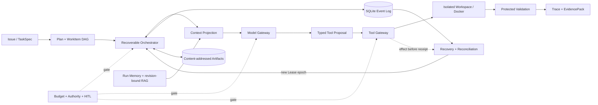

# Horizon 实习求职作品集包

更新：2026-10-30。适用代码：`main` / v0.3.0 之后。

这份文档把项目已有的实现、证据和边界整理成可直接用于简历、项目介绍、现场演示和技术追问的
统一入口。它不新增能力，也不把 Scripted Model 评测包装成真实模型修复成绩。详细实现合同仍以
[开发设计](coding-agent-development-design.md)、[能力设计](agent-capabilities-design.md)和
[逐项需求追踪](requirements-traceability.md)为准。

## 1. 项目定位

### 15 秒版本

> Horizon 是一个面向长程软件工程任务的可恢复 Coding Agent Harness。它用事件日志、Worker
> Lease、持久检查点和副作用对账，让 Agent 在进程崩溃、上下文超限或预算耗尽后安全恢复，
> 并用 protected validation、可重放 Trace 和 EvidencePack 区分“模型说完成”与“任务已验证”。

### 30 秒版本

> 我没有再做一个聊天式 Coding Agent，而是实现它下面的可靠执行控制层。任务先被结构化为
> TaskSpec 和 WorkItem DAG；模型只能提出 typed tool proposal，Tool Gateway 再检查权限、预算、
> revision 和前后态。每次状态迁移写入 SQLite 事件流，Lease epoch 隔离旧 Worker；当进程在文件
> 已写入但 receipt 未提交时退出，系统先标记 unknown，再根据精确后态接纳或阻塞，而不是直接
> retry。最后只有 protected validation 通过，才导出可离线重放的 Trace 和 EvidencePack。

## 2. 一张图讲清架构

主线是“任务合同 → 规划 → 有界上下文 → 模型提议 → 受控工具 → 保护验收 → 证据交付”。恢复环
不绕过主线：新 Worker 必须从事件重建状态、取得新 Lease epoch，并先处理旧调用的已生效、未生效
或 unknown 后态，才允许继续执行。

## 3. 五个核心设计决定

1. **事件日志是权威状态。** 内存对象和完整 transcript 都可以重建；恢复不能相信进程退出前的
   内存缓存。内容较大的 session、工具输出和快照进入内容寻址 ArtifactStore，事件只保存引用。
2. **模型是提议者，不是执行权限主体。** TaskSpec、执行模式、路径 allowlist 和 Gateway 参数
   schema 共同收窄权限。模型输出不能扩大权限，也不能直接把 Run 标成成功。
3. **不把“无 receipt”解释成“没执行”。** 对有副作用调用先持久化 intent；崩溃后根据调用 ID、
   workspace revision、派发前 manifest 和唯一后态进行 reconciliation。不足以证明安全时保留
   `unknown`，不自动重派。
4. **上下文是投影，不是事实源。** TaskSpec、权限、预算、required checks、未完成 tool call 和
   关键 digest 属于必保内容；Run Memory 只接收可由工具回执重建的事实，Code RAG 绑定精确
   workspace revision。最小安全投影仍超限时，先持久暂停并释放 Lease。
5. **成功由验证器决定。** 模型的 `submit` 只触发 protected validation。最终 Trace 必须能脱离
   SQLite、模型、网络和存活 Worker 重放；EvidencePack 再绑定交付文件大小、SHA-256 和语义关系。

## 4. 代码导览

| 问题 | 主要实现 | 面试时说明 |
|---|---|---|
| 任务与计划怎样约束执行 | [`domain/task.py`](../src/horizon/domain/task.py)、[`domain/plan.py`](../src/horizon/domain/plan.py) | TaskSpec 保存验收、预算和权限；WorkItem DAG 保存依赖和阶段状态 |
| 权威状态怎样重建 | [`domain/run.py`](../src/horizon/domain/run.py)、[`domain/events.py`](../src/horizon/domain/events.py)、[`adapters/persistence/sqlite.py`](../src/horizon/adapters/persistence/sqlite.py) | append-only 事件经纯投影函数还原 Run，JSONL 可以离线 replay |
| Agent 主循环怎样推进 | [`application/agent_loop.py`](../src/horizon/application/agent_loop.py)、[`application/supervision.py`](../src/horizon/application/supervision.py) | 每轮取得 Lease、投影上下文、调用模型、执行一个受控动作并形成可恢复边界 |
| 真实子进程怎样接力 | [`application/local_process_supervision.py`](../src/horizon/application/local_process_supervision.py) | PID launch receipt 与 Lease/epoch/session 绑定；父进程同步 reap 后才允许下一任 Worker |
| Context、Memory、RAG 怎样分层 | [`application/context.py`](../src/horizon/application/context.py)、[`application/memory.py`](../src/horizon/application/memory.py)、[`adapters/retrieval/sqlite_fts.py`](../src/horizon/adapters/retrieval/sqlite_fts.py) | Context 是有界调用视图；Memory 是可失效事实；RAG 是 revision-bound 代码证据 |
| 工具为什么不会直接越权 | [`tools/gateway.py`](../src/horizon/tools/gateway.py)、[`domain/tools.py`](../src/horizon/domain/tools.py) | typed 参数、路径权限、预算、revision 和前后态检查在模型之外执行 |
| 崩溃后如何决定 retry/accept/block | [`application/recovery.py`](../src/horizon/application/recovery.py)、[`application/tool_recovery.py`](../src/horizon/application/tool_recovery.py) | 先分类事实再选择处置；unknown 不等于失败，也不等于可重派 |
| 费用怎样控制 | [`adapters/persistence/campaign_budget.py`](../src/horizon/adapters/persistence/campaign_budget.py)、[`adapters/model/config.py`](../src/horizon/adapters/model/config.py) | Campaign/Run 双层 CNY 账本；reservation、settlement 和 unknown 用量均持久化 |
| 如何证明运行真的发生过 | [`application/terminal_evidence.py`](../src/horizon/application/terminal_evidence.py)、[`application/portfolio_demo.py`](../src/horizon/application/portfolio_demo.py)、[`application/run_ab_eval.py`](../src/horizon/application/run_ab_eval.py) | 导出 Trace、最终投影、EvidencePack 与来源绑定 A/B 报告，并由独立 verifier 复核 |

## 5. 当前可验证证据

| 可说的结论 | 当前证据 | 必须同时说出的边界 |
|---|---|---|
| 主作品集恢复链可一键复现 | `horizon demo run --human`：真实子进程在写入生效、receipt 前以 86 退出；恢复到 final epoch 3，Trace 与 EvidencePack 自检通过 | 冻结 Scripted Model、固定 `replace_text` 窗口；不是任意崩溃或真实模型能力 |
| 来源绑定完整 checkout 合同可执行 | 9 个项目、22 个作者选择案例在禁网 Docker 中完成初始失败确认、Baseline 等待、Treatment 恢复，公开 workflow 为 22/22 | 使用 Scripted Model；不是官方 BugsInPy 或 SWE-bench 成绩 |
| 多阶段任务能跨 Worker 继续 | youtube-dl、Luigi、FastAPI 各 3 个依赖 WorkItem、2 次持久重启，公开复跑 3/3 | 安全边界重启，不是任意指令点或跨主机容灾 |
| effect-before-receipt 可保守对账 | Luigi `replace_text/accept_replace` 与 FastAPI `create_file/accept_create` 共 2/2；恢复模型重派 0、重复副作用 0、最终 open effect 0 | 两个固定、作者选择的故障窗口，不承诺 exactly-once |
| 词法 Code RAG 有冻结定位基线 | 7 项目 24 案例中公开 16 个 development：Hit@1 `11/16`、Hit@5 `16/16`、MRR `0.817708`；8 个 holdout 保持密封 | 有 3 个 degraded；中文困难改写仅 `1/8`，没有 symbol/vector RAG 或端到端收益结论 |
| 真实 Provider 路径和费用门禁实际运行过 | 9 个 SiliconFlow Pilot、26 个已结算调用，累计 `CNY 0.2306292`；费用、Trace 与 source isolation 可核对 | 9 个 Run 均未完成代码编辑和 protected validation，属于负结果 |
| 下一轮真实模型评测输入已冻结 | 5 个不同项目的低复杂度 development smoke；首条 TheFuck-2 已运行一次，结算 `CNY 0.013263` 后由单调用预算门限停止；新 execution sizing preflight 会拒绝原 `CNY 0.060` 配置 | 作者在已知 Scripted Model 修复后选题；其余 4 条尚未运行，也没有新的付费授权 |
| 当前离线回归稳定 | `662 passed, 11 skipped`；标准 CI、外部检索证据和来源绑定 Docker workflow 均通过 | 11 个本地 skip 需要现成 Docker 镜像，不能说成本机全通过 |

最新公开复核入口：

- [标准 CI 41034089539](https://github.com/caoshangrui-spec/horizon-coding-harness/actions/runs/41034089539)
- [外部检索证据 41034089657](https://github.com/caoshangrui-spec/horizon-coding-harness/actions/runs/41034089657)
- [来源绑定 Docker 证据 41034089567](https://github.com/caoshangrui-spec/horizon-coding-harness/actions/runs/41034089567)

## 6. 可直接放进简历的中文版

### 项目标题

**Horizon — 面向长程软件工程任务的可恢复 Coding Agent Harness**

Python 3.12/3.13 · Pydantic · Typer · SQLite/FTS5 · Docker · Pytest · GitHub Actions

### 一句话描述

独立设计并实现 Coding Agent 的可靠执行控制层，覆盖任务分解、持久化状态机、Worker 崩溃恢复、
上下文/Memory/RAG 分层、预算与权限门禁、保护验收和可重放证据链。

### 建议使用的四条项目要点

- 设计 append-only 事件投影、内容寻址 Artifact 和 Lease epoch 围栏，使本地 Agent Worker 能从
  持久事实恢复；在父进程、模型返回、工具写入和 promotion 等提交窗口保留可审计恢复边界。
- 实现 typed Tool Gateway 与 effect-before-receipt 对账：当文件已改变但 receipt 未提交时先标记
  `unknown`，再以 revision/manifest/后态精确 `accept` 或阻塞；两个来源绑定 hard-crash 案例
  2/2 恢复，模型重派、重复副作用和最终 open effect 均为 0。
- 构建确定性 Context Projection、run-scope Memory 与 revision-bound SQLite FTS5 Code RAG；
  必保上下文超限时在模型派发前持久暂停，并以新 Lease epoch 和消息不变的新 session 续跑。
- 建立禁网 Docker A/B 与 EvidencePack 评测：22 个完整 checkout 案例、3 个多阶段恢复案例和
  2 个硬崩溃案例公开通过；离线回归持续通过，同时保留 9 次真实模型未完成修复的负结果。

### 不建议写进简历的说法

- “通过 SWE-bench”或“真实 Issue 修复成功率达到某个比例”。
- “保证 exactly-once”或“支持分布式容灾”。
- “实现了自动模型 fallback、向量 RAG、通用多 Agent 协作”。
- “九轮真实模型实验成功”。九轮证明的是 Provider、预算、Trace 和失败诊断链，不是修复能力。

## 7. English resume version

### Project title

**Horizon — Recoverable Coding Agent Harness for Long-Horizon Software Engineering Tasks**

### Resume bullets

- Designed and implemented an event-sourced control plane for coding agents with durable checkpoints,
  content-addressed artifacts, worker lease fencing, bounded budgets, and replayable JSONL traces.
- Built conservative effect-before-receipt recovery: unresolved writes are classified as `unknown`
  and reconciled against revision-bound manifests before accept, retry, or manual blocking; two
  source-bound hard-crash cases recovered with zero model redispatches and zero duplicate effects.
- Implemented deterministic context projection, run-scoped evidence memory, revision-bound SQLite
  FTS5 code retrieval, typed tool authorization, protected Docker validation, and offline EvidencePack
  verification.
- Evaluated the harness on 22 full-checkout scripted cases, three multi-stage recovery cases, and two
  hard-crash cases in network-disabled Docker workflows; maintained 660 passing offline tests while
  explicitly preserving eight unsuccessful real-model pilot runs as negative evidence.

## 8. STAR 项目故事

### Situation

普通 Coding Agent Demo 常把一次模型调用成功当成项目完成，但长程任务会跨多次模型、工具和进程。
进程退出时，“没有 receipt”无法说明外部写入或付费调用没有发生，直接 retry 会产生重复副作用。

### Task

实现一个最小但可验证的 Harness：保存权威状态、隔离旧 Worker、控制权限和费用、在受支持故障点
恢复，并为每项结论留下可离线复核的证据，而不是先做 UI、多 Agent 或分布式调度。

### Action

我把 TaskSpec、Plan、Run、AgentSession、tool intent/receipt 和 validation 结果建模为事件投影；用
Lease epoch 做提交围栏，用内容寻址 Artifact 保存大对象；把模型限制为 typed proposal；为文件
写入建立派发前 manifest 和 CAS 后态；为真实子进程增加 PID/launch/Lease 绑定；最后用禁网 Docker、
故障注入、Trace replay 和 EvidencePack verifier 构建验证闭环。

### Result

本地一键演示能够在写入生效、receipt 前强制退出并安全恢复；公开 workflow 通过 22/22 完整
checkout、3/3 多阶段和 2/2 hard-crash 合同，离线回归为 662 passed。真实模型九轮没有完成修复，
但失败被完整保留并驱动了上下文容量、检索缓存隔离和预算诊断改进。

### Reflection

这个项目最重要的取舍是把“可靠执行”和“模型能力”分开。Harness 的恢复合同可以用确定性模型和
故障注入验证；真实模型是否会修好 Issue 必须用独立任务集和成功率评测，不能由前者外推。

## 9. 90 秒架构讲解

> 输入先变成 TaskSpec，其中包含目标、路径权限、预算和 required checks，再拆成带依赖的 WorkItem。
> Orchestrator 每轮从 append-only 事件重建 Run，取得带 epoch 的 Worker Lease，然后从 TaskSpec、
> 最近闭合轮次、Run Memory 和当前 revision 的 Code RAG 生成有界 Context Projection。模型只返回
> typed proposal；Tool Gateway 在模型之外验证 schema、权限、预算、revision 和前后态。
>
> 每个有副作用动作先保存 intent，再执行 effect，最后提交 receipt。如果 Worker 在 effect 和
> receipt 之间崩溃，恢复器不会因为“没 receipt”就 retry，而是把它标为 unknown、围栏旧 Lease，
> 再用派发前 manifest 和当前后态决定 accept、证明未生效后重派，或要求人工处理。模型提交完成
> 只会触发 protected validation；最终把事件导出为 Trace，从 Trace 复算 Run 投影，再用
> EvidencePack 绑定报告、摘要、崩溃标记和检索 Artifact。这样我能分别回答“系统如何恢复”和
> “这次任务是否真正通过”。

## 10. 高频技术追问

### 1. 为什么不用数据库里的 Run 行直接更新状态？

单行状态看不到因果过程，也无法判断崩溃发生在 intent、effect 还是 receipt 之间。追加事件保留
顺序和因果，Run 只是可重建投影；恢复和离线审计使用同一投影规则，避免两套真相。

### 2. Checkpoint 和 Event Log 有什么区别？

Event Log 是权威事实；Checkpoint/Artifact 是加速恢复或保存大对象的内容寻址快照。Checkpoint
损坏可以由事件重新计算，不能反过来覆盖事件历史。

### 3. Lease epoch 与 PID 分别解决什么问题？

PID 用来确认父进程等待和回收的是哪个直接子进程；Lease epoch 决定谁仍有资格提交持久状态。
即使旧进程异常恢复，过期 epoch 也会阻止其继续提交。两者不能互相替代。

### 4. 为什么不承诺 exactly-once？

SQLite、文件系统、Docker 和外部 Provider 不共享一个事务。Horizon 提供 intent/receipt、幂等
标识、CAS 和保守 reconciliation，在已覆盖窗口内避免重复；无法证明后态时明确阻塞，而不是把
有限恢复合同宣传成所有外部系统的 exactly-once。

### 5. Context、Memory、RAG、Trace 的区别是什么？

Context 是一次模型调用可见的有界投影；Run Memory 是从工具证据重建、可按 revision 失效的事实；
Code RAG 是当前 workspace revision 下的代码片段；Trace 是控制器实际发生过的事件历史。Trace
不是给模型看的知识库，Context 也不是权威事实源。

### 6. 上下文压缩怎样避免丢约束？

只折叠已闭合的模型—工具单元，TaskSpec、权限、预算、required checks、未完成调用和内容 digest
属于 Mandatory Facts。压缩后重新验证事实集合；如果必保内容本身仍超限，则在派发模型前进入
类型化等待并释放 Lease，不通过删掉约束强行继续。

### 7. Tool Calling 怎样做权限控制？

模型输出先解析为 typed args。Gateway 再取 TaskSpec allowlist、执行模式、工具能力和当前状态的
交集，并检查路径、revision、预算及预期前态。模型可以选择允许的动作，不能创造新权限。

### 8. HITL 在哪里？

当前是有界、类型化入口：replacement Plan、operator guidance、context-capacity retry、悬空工具
处置和 promotion 各有持久请求/决策。决策绑定 actor、请求 hash、版本和 session，并原子消费。
尚未实现多用户身份、通用审批 UI 或所有决策类型的统一超时策略。

### 9. 为什么默认关闭模型 fallback？

换 Provider/模型可能改变费用、数据流向、上下文限制和工具能力。只有预先声明兼容性、权限和独立
预算后才应启用；当前 `fallback_enabled=false`。检索 scan fallback 会显式标成 degraded，也不能
把缺失证据包装成成功。

### 10. RAG 的效果怎样？

当前是 revision-bound 词法 FTS5，不是向量检索。16 个公开 development 案例达到 Hit@5 16/16、
MRR 0.817708，但中文困难改写只命中 1/8，且八次真实模型 Pilot 没有形成修复成功。因此可以说
“有冻结定位基线和失败分析”，不能说“RAG 已提升端到端成功率”。

### 11. 如何证明恢复没有重复执行？

检查旧 call ID 是否再次派发、恢复 receipt 是否唯一、workspace 后态是否唯一、模型 invocation ID
是否新增、最终是否存在 open effect；再从 JSONL Trace 重放同一投影。来源绑定 hard-crash v2 的
4 条 arm 中这些指标均被 workflow 门控。

### 12. Scripted Model 测试有什么价值？

它固定决策序列，让实验只改变 Harness 机制，可以重复注入同一个崩溃窗口并验证状态机不变量。
它适合证明恢复、预算和权限合同，不适合证明模型会理解或修复未知 Issue。

### 13. 九轮真实模型为什么都失败，项目还有价值吗？

这说明真实修复能力尚未达到验收，而不是 Harness 证据无效。负结果分别暴露了规划反馈、大文件
读取、范围参数、错误路径、费用预留和上下文容量问题，并且 Trace 能定位停止原因。面试时应把
“可靠性控制层已验证”和“模型任务成功率仍未知”作为两个独立结论。

### 14. 为什么没有先做 Redis、Celery、Kubernetes 或多 Agent？

分布式组件不会自动解决状态权威、旧 Worker 围栏和副作用对账。先在单机直接子进程上验证这些
不变量，后续才能把 Lease 和队列替换为跨主机实现；当前项目明确不宣称分布式容灾。

### 15. 如果继续生产化，优先做什么？

先用新增 execution sizing gate 把工具回执、上下文上限和单调用费用合同调到可持续，再在明确的新
授权下只跑 1 条 easy 任务，确认规划—检索—编辑—验证闭环；随后才扩到 5 条和冻结的 20～30 个
独立任务，建立成功率、成本和失败分类基线。之后再补 Provider receipt 查询、进程树/OS 故障恢复
和跨主机 Lease。只有词法检索成为主要
瓶颈时，才引入 symbol/vector 索引；UI 和自由多 Agent 不应先于这些证据缺口。

## 11. 现场演示清单

1. 先说问题：effect 已发生但 receipt 未提交时，直接 retry 会重复写入。
2. 运行：`uv run --locked --cache-dir .uv-cache horizon demo run --human`。
3. 指出 `Durable worker handoffs: 2`、`Crashed child exit code: 86`、`Final lease epoch: 3`。
4. 指出 `Unknown write was conservatively classified` 与 `Exact existing effect was accepted once`。
5. 指出 `Protected final validation passed`、`Trace replay matched final state` 和外部费用 0。
6. 使用输出末尾命令再次验证 EvidencePack；需要更强演示时先删除三个 SQLite 文件。
7. 主动说明：这是固定 Scripted Model 故障链，不是 SWE-bench 或真实模型成功率。

完整 3 分钟讲稿和脱库命令见[面试演示指南](interview-demo.md)。

## 12. 证据边界速查

| 面试官问法 | 可以回答 | 不应回答 |
|---|---|---|
| “你做的是 Agent 吗？” | 做的是 Coding Agent 的 Harness/control plane，包含真实 Agent loop、模型和工具 adapter | “训练了一个 Coding LLM” |
| “能自动修复真实 Issue 吗？” | Scripted Model 的来源绑定合同可执行；真实模型路径跑过但九轮未成功 | “已经有真实修复成功率” |
| “崩溃后一定不会重复吗？” | 已覆盖窗口使用 intent/receipt、Lease、CAS 和对账，两个来源绑定案例零重复 | “任意外部副作用 exactly-once” |
| “RAG 做得好吗？” | 有 24-case 冻结定位集、公开 development 指标和中文负结果 | “RAG 已显著提高端到端修复率” |
| “支持分布式吗？” | 边界和接口可替换，目前验证的是本地直接子进程 | “支持跨主机高可用” |
| “EvidencePack 是签名吗？” | 是包内自洽哈希、Trace 重放和语义验证 | “第三方签名、可信时间戳或来源认证” |

## 13. 针对不同岗位的强调顺序

- **Agent / LLM Infra 实习：** Context、Memory、RAG、Tool Calling、预算、Provider 边界，再讲
  Trace 驱动的九轮负结果诊断。
- **后端工程实习：** 事件投影、幂等、Lease fencing、事务边界、副作用对账、故障注入和 CI。
- **平台 / DevOps 实习：** 子进程生命周期、禁网 Docker 验收、EvidencePack、可重放审计和
  来源绑定 workflow。
- **测试开发实习：** 状态机不变量、fault injection、A/B manifest、负结果保留、独立 verifier
  和 claim boundary。

无论岗位如何调整，简历和面试都应保留一句边界：**当前强项是 Harness 的恢复与证据链，真实
模型端到端修复能力仍未通过固定任务集验收。**
