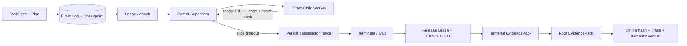

# Horizon：3 分钟面试演示与架构讲解

这是一份面向实习面试的讲解入口。目标不是在三分钟里罗列所有模块，而是用一个真实、零费用、
可复核的进程故障案例说明：Horizon 为什么是 Coding Agent Harness，而不只是一次模型调用脚本。

## 一句话定位

> Horizon 是面向长程软件工程任务的可恢复 Coding Agent Harness：它把任务、模型调用、工具
> 副作用、Worker Lease、预算、人工决策和验收证据放进同一个可重放状态机，使进程中断后能够
> 先判断已经发生了什么，再安全续跑或明确阻塞。

## 3 分钟讲解稿

### 0:00～0:25：先讲问题

“普通 Coding Agent Demo 往往只展示一次成功对话，但长程任务会跨多个模型和工具轮次。真正
困难的是：Worker 中断后，系统不能确定写入或付费调用是否已经发生。如果直接 retry，可能重复
改代码、重复计费，甚至把部分成功误报成完成。Horizon 主要解决的是这个执行可靠性问题。”

### 0:25～1:00：再讲核心架构

“任务先变成有验收条件和权限边界的 TaskSpec，再拆成 WorkItem DAG。每个执行动作都经过
Harness：事件日志保存权威状态，Lease epoch 隔离旧 Worker，Context Projection、Run Memory
和 revision-bound Code RAG 为模型组装有来源的上下文，模型只提出 typed tool proposal，真正的
读写由 Tool Gateway 做权限、预算和前后态检查。最后必须通过 protected validation，Trace 和
EvidencePack 才能说明这次运行实际发生了什么。”

### 1:00～1:50：现场运行真实故障链

“我现在运行的是最窄、最容易复核的版本。它会启动一个阻塞在 stdin gate 的真实直接子进程；
父进程先把 launch ID、PID、Lease 和 epoch 落入 Trace并持久授权，才放行子进程。子进程只读
重开 SQLite、复核该授权后发布 ready marker。父进程随后故意触发 slice timeout：先写精确取消
目标，之后才 terminate/wait、记录两类停止 receipt、释放 Lease并把 Run 置为 CANCELLED。”

运行下方命令，并指出输出中的 `process_id`、`lease_epoch`、`event_order`、`status` 和
`external_cost_cny`。事件序号必须满足：

```text
launch
  < PROCESS_WORKER_LAUNCHED
  < PROCESS_WORKER_START_AUTHORIZED
  < CANCEL_WORKER_STOP_PENDING
  < PROCESS_WORKER_STOPPED
  < CANCEL_WORKER_STOPPED
  < LEASE_RELEASED
  < CANCEL_REQUESTED
```

### 1:50～2:30：展示脱库复核

“演示结束后临时数据库已经删除，只留下 EvidencePack。我再用独立命令检查文件大小和 SHA-256、
重放 JSONL Trace、复算最终 Run 投影，并把 child-ready 与父进程 observation 重新绑定到同一个
launch ID、PID、Lease、epoch 和事件链。仅仅修改 PID 并重算文件哈希也会被语义校验拒绝，所以
它不是只看一个成功字符串。”

### 2:30～3:00：主动说清边界

“这个案例证明一个本地直接子 Worker 的父侧 timeout、先栅栏后停止和同步回收，不证明父进程或
操作系统崩溃恢复，也不证明跨主机 exactly-once。更完整的仓库里还实现了 pending effect 对账、
上下文压缩、Run Memory、Code RAG、预算门禁、有界 operator-guidance HITL 和 protected
validation，但真实模型七轮 Pilot 都是负结果，所以我把 Harness 可靠性证据与模型修复能力明确
分开。”

## 现场演示命令

首次准备环境：

```powershell
uv sync --locked
```

运行演示并直接取得本次唯一 EvidencePack 路径：

```powershell
$result = uv run --locked --cache-dir .uv-cache horizon demo process-timeout |
  ConvertFrom-Json
$result | Format-List
uv run --locked --cache-dir .uv-cache horizon demo verify-process-timeout `
  "$($result.evidence_pack)"
```

不指定 `--output` 时会在 `.horizon/demos/` 下创建唯一目录，不覆盖旧证据。两条命令都不调用
模型、网络、Docker、工具或被测仓库代码，外部费用为 0。若现场时间很短，只展示第一次输出的
`event_order`，再运行独立 verifier 即可。

## 一张图说明数据流



本演示只执行图中的进程监督与证据链。完整 Agent 主链路还包含以下四个面：

| 面 | 当前设计 | 为什么需要 |
|---|---|---|
| 编排与恢复 | TaskSpec、WorkItem DAG、追加式事件、Checkpoint、Lease epoch | 新 Worker 从持久事实继续，旧 Worker 不能继续提交 |
| 上下文与知识 | Mandatory Facts、确定性 Context Projection、Run Memory、revision-bound Code RAG | 压缩历史时不丢权限/验收，代码证据不会跨 revision 静默复用 |
| 动作与治理 | Model Gateway、typed Tool Calling、Tool Gateway、Campaign/Run 预算、有界 operator-guidance HITL | 模型提出动作，但不直接获得无边界执行权 |
| 验收与证据 | protected validation、Trace replay、EvidencePack、失败/unknown 原样保留 | “代码改了”与“任务通过”分开，失败也能审计 |

## CI EvidencePack

标准 [CI workflow](https://github.com/caoshangrui-spec/horizon-coding-harness/actions/workflows/ci.yml)
在 Linux runner 上重新运行同一演示和独立 verifier，成功后上传名为
`horizon-process-timeout-evidence` 的 workflow artifact，保留 14 天。打开一次成功的 workflow
run，在页面底部下载并解压；根 `evidence-pack.json` 与 `child-ready.json`、
`supervision-observation.json` 位于同一目录，可再次运行：

```powershell
uv run --locked --cache-dir .uv-cache horizon demo verify-process-timeout `
  <解压目录>/evidence-pack.json
```

GitHub Actions artifact 通常需要登录 GitHub 后下载；它是 CI 发布的限时证据，不是匿名永久发布
资产。包内哈希提供自洽性与防意外修改能力，不是签名、可信时间戳或第三方来源认证。

## 高频追问与回答要点

### 1. 为什么不直接 retry？

因为进程退出只能证明没有 receipt，不能证明外部 effect 没发生。Horizon 先用持久化 intent、
调用 ID、工作区 revision 和前后态把结果分类为可确认、可回滚或 `unknown`；只有满足策略的
只读操作或已证明未生效的动作才允许重派。否则显式阻塞，避免重复写入和重复计费。

### 2. Lease epoch 和 PID 各解决什么？

PID 证明父进程实际等待和回收的是哪个直接子进程；Lease ID/epoch 是持久化提交权限。进程停止
后必须先留下 stop receipt，再释放该 Lease。即使旧 Worker 之后异常恢复，也不能用过期 epoch
继续提交状态。

### 3. Context、Memory、RAG、Trace 有什么区别？

- Context 是某次模型调用实际可见的有界视图；完整 transcript 不被投影覆盖。
- Run Memory 只保存控制器从工具结果中可重建、可失效的事实，不接受模型猜测冒充事实。
- Code RAG 从指定 workspace revision 检索带路径、范围和哈希的代码证据。
- Trace 是执行中真正发生过的事件，不是给模型看的知识库。

压缩只折叠已闭合的旧模型—工具单元；TaskSpec、权限、预算、required checks、未完成 tool call
和内容摘要 digest 不能静默丢弃。必保内容仍超限时停止派发，不通过删约束换取继续运行。

### 4. 这里怎样做“意图识别”？

首版不训练独立意图分类器。CLI 控制命令走确定性路由，软件任务通过结构化 TaskSpec 标记任务
类型、执行模式、路径权限和验收要求，再生成或读取 Plan。无法确定会改变权限、预算或验收的
当前实现不会让自由文本分类结果直接授权工具执行；通用澄清审批仍是设计边界，不冒充已完成的
HITL 功能。

### 5. Fallback 为什么默认不开？

静默换模型可能改变费用、数据流向、工具能力和上下文限制。当前 Provider 配置把
`fallback_enabled` 固定为 `false`，没有自动跨模型切换。设计上只有预先声明兼容 Provider/模型、
数据权限和独立预算后才应增加有界 fallback；这部分不能当作当前已实现能力。已有词法检索的
scan fallback 会显式标记 degraded，不能把 `evidence_missing` 包装成通过。

### 6. 为什么没有先上 Redis、Celery、Kubernetes 或多 Agent？

项目要先证明单机 Harness 的恢复不变量：状态权威、旧 Worker 围栏、副作用对账、预算和验收。
分布式调度会增加组件，却不会自动解决这些问题。当前边界明确是本地直接子进程；跨主机 Lease、
父控制器被硬 kill 后，持久 launch 阻止新 Lease、精确 PID 人工停止确认和原 session 续跑已有
离线故障注入证据；自动探活/重启、OS 灾难恢复与进程树回收仍属于后续生产化工作。

### 7. EvidencePack 到底证明了什么？

它证明包内文件的完整性、Trace 可重放、最终投影与指定语义关系一致。这个演示额外证明一次真实
直接子进程的 timeout 和同步 reap。它不证明官方 SWE-bench 成绩、模型修复能力、恶意代码隔离
认证、外部系统 exactly-once，也不证明任意崩溃窗口都已覆盖。

## 面试时不要说过头

- 不说“通过了 SWE-bench”；当前外部案例是来源绑定、作者选择且使用 Scripted Model 的评测。
- 不说“保证 exactly-once”；当前保证的是可审计 intent/receipt、保守 unknown 和有限窗口恢复。
- 不说“支持分布式容灾”；当前进程证据覆盖本地直接子 Worker。
- 不把七轮真实模型 Pilot 的可重放失败说成修复成功；它们是保留的负结果。
- 不把 Docker 限制参数说成安全沙箱认证。

更细的实现合同见[直接子 Worker 超时取消演示](process-timeout-cancellation-demo.md)、
[能力设计](agent-capabilities-design.md)、[上下文投影](context-projection.md)和
[Run Memory](run-memory.md)。
